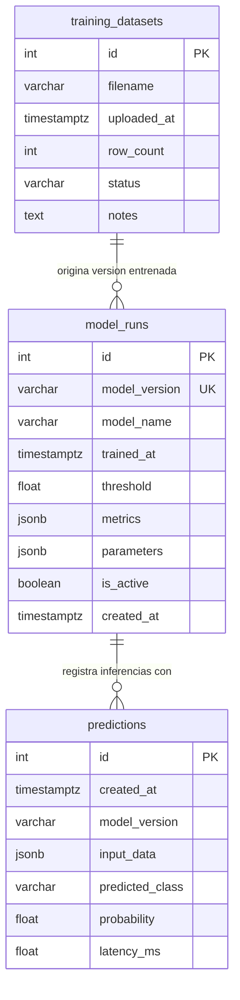

# Base de Datos: Información de Predicciones y Modelos de IA

Este directorio contiene el script DDL de creación de la base de datos, el diagrama entidad-relación y el procedimiento para su generación en **Supabase** (PostgreSQL).

---

## 📊 Diagrama Entidad-Relación (ERD)

---

## 📋 Descripción de Tablas

1. **`model_runs`**:
   * Controla las versiones y ciclos de vida del modelo de ML.
   * Guarda los hiperparámetros seleccionados y las métricas obtenidas (MCC, ROC-AUC, Matriz de Confusión) en formato semiestructurado JSONB.
   * Almacena el `threshold` óptimo (umbral de probabilidad calibrado para minimizar el costo financiero 3:1).

2. **`predictions`**:
   * Cumple con el **Requerimiento 2.b**: almacena cada petición realizada al endpoint `/predict`.
   * Guarda los datos demográficos y laborales enviados (`input_data`), la clase predicha (`<=50K` o `>50K`), la probabilidad calculada y la latencia del cálculo en milisegundos.

3. **`training_datasets`**:
   * Cumple con el **Requerimiento 2.e**: registra los archivos CSV de entrenamiento cargados desde la interfaz web para auditoría y trazabilidad del re-entrenamiento.

---

## 🛠️ Procedimiento de Generación en Supabase

### Opción 1: Mediante el SQL Editor de Supabase (Recomendada)
1. Iniciar sesión en el panel web de [Supabase](https://supabase.com).
2. Seleccionar el proyecto del curso.
3. Ir a la pestaña **SQL Editor** en el menú lateral izquierdo.
4. Crear una nueva consulta (`+ New query`).
5. Copiar y pegar el contenido íntegro de [`schema.sql`](./schema.sql).
6. Presionar **Run** (Ejecutar). Verificar que las tablas aparezcan en el **Table Editor**.

### Opción 2: Automáticamente desde el Notebook o Backend
El notebook `notebooks/modelo_crisp_ml.ipynb` y el backend en FastAPI utilizan SQLAlchemy con `MetaData.create_all(engine)` para verificar y autogenerar las tablas si aún no existen, utilizando la cadena de conexión definida en `SUPABASE_DB_URL`.

