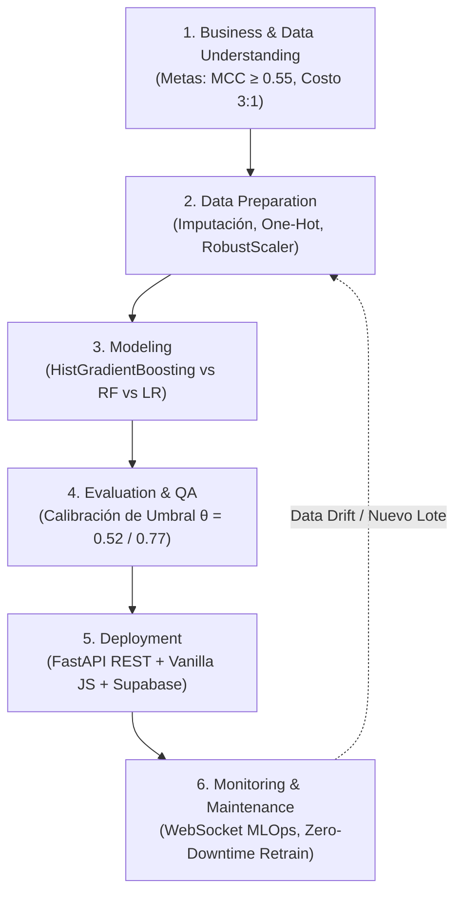
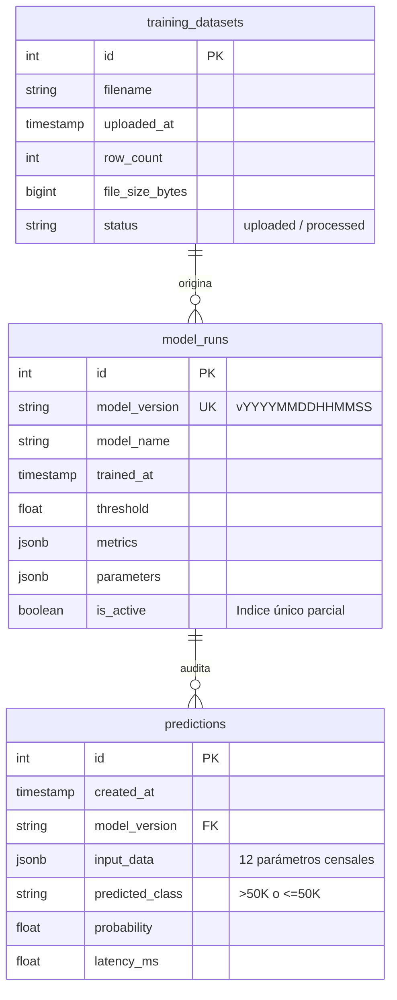
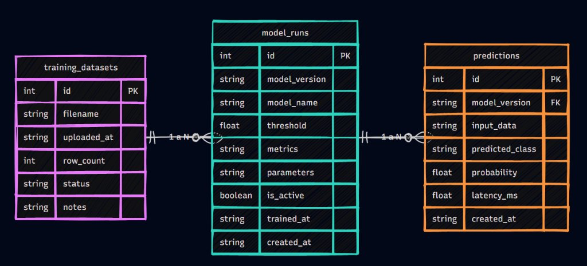

# INFORME TÉCNICO Y METODOLÓGICO FINAL
## Sistema de Inteligencia Artificial para Precalificación Crediticia Automatizada

**Materia:** Trabajo Final de Grado / Taller de Sistemas  
**Institución:** Universidad Católica Boliviana "San Pablo", Sede Tarija  
**Autor:** Alberto Esteban Mamani Donaire  
**Metodología:** CRISP-ML(Q) (*Cross-Industry Standard Process for Machine Learning with Quality Assurance*)  
**Repositorio GitHub:** [https://github.com/AlbertoMamaniD/Adults-Census](https://github.com/AlbertoMamaniD/Adults-Census)  
**Fecha:** Noviembre de 2026  

---

## 📌 1. Resumen Ejecutivo y Planteamiento del Problema

El presente proyecto desarrolla una solución integral de Inteligencia Artificial para la industria financiera, específicamente orientada a la **precalificación automatizada de solicitantes de productos crediticios de alto monto** (tarjetas de crédito corporativas, líneas preferenciales o créditos quirografarios).

### El Problema de Negocio Bancario
En el otorgamiento de créditos, el objetivo no es simplemente maximizar el porcentaje general de aciertos (*accuracy*), sino gestionar el riesgo patrimonial bajo una **función de pérdida asimétrica**:
1. **Falso Positivo (FP - Otorgar crédito a un cliente insolvente):** Genera pérdidas directas de capital por incobrabilidad, reservas obligatorias por morosidad y altos costos judiciales de cobranza. Se le asigna una penalización de **Costo 3x**.
2. **Falso Negativo (FN - No ofertar a un cliente solvente):** Representa un costo de oportunidad comercial (intereses no percibidos), pero no compromete los fondos de los ahorristas del banco. Se le asigna una penalización de **Costo 1x**.
3. **Función de Riesgo Cuantificada:** $\text{Costo Total} = 3 \times FP + 1 \times FN$.

### Formulación de Machine Learning
* **Tipo de Tarea:** Aprendizaje Supervisado — Clasificación Binaria.
* **Variable Objetivo ($Y$):** Ingreso bruto anual del solicitante censal (`>50K` [Solvente / Clase Positiva] vs `<=50K` [Insolvente / Clase Negativa]).
* **Dataset:** *Adult Census Income* (Kaggle / UCI Machine Learning Repository), compuesto por 32.561 registros censales y 14 características sociodemográficas y económicas.
* **Desafío Estadístico:** Fuerte desbalance de clases (76% clase `<=50K` y 24% clase `>50K`).
* **Métrica Principal:** **MCC (*Matthews Correlation Coefficient*) $\ge 0.55$**, obligatoria debido a que el *Accuracy* es engañoso en carteras no balanceadas (un modelo ingenuo que rechace a todos tendría 76% de exactitud pero cero utilidad predictiva).

---

## 🔄 2. Aplicación Rigurosa de la Metodología CRISP-ML(Q)

El desarrollo del modelo de Machine Learning siguió las 6 fases del estándar internacional **CRISP-ML(Q)**:

### Fase 1: Business & Data Understanding (Comprensión del Negocio y los Datos)
* **Cronograma:** Diseñado y documentado formalmente en `docs/cronograma/Cronograma_CRISP-ML(Q).docx` abarcando las 6 etapas del ciclo de vida.
* **Análisis Exploratorio de Datos (EDA):** Realizado en el notebook `notebooks/modelo_crisp_ml.ipynb`. Se identificaron relaciones determinantes entre el nivel educativo numérico (`education_num`), la ganancia de capital (`capital_gain`), las horas trabajadas por semana (`hours_per_week`) y la probabilidad de pertenecer al estrato de altos ingresos.

### Fase 2: Data Preparation (Preparación de Datos)
* **Limpieza de Nulos:** Detección de caracteres de escape `?` en atributos categóricos (`workclass`, `occupation`, `native_country`) e imputación por valor modal o categoría de respaldo `"Unknown"`.
* **Depuración de Variables Redundantes:** Descarte de `fnlwgt` (ponderador censal demográfico que no aporta información sobre solvencia individual) y eliminación de `education` preservando su codificación numérica canónica `education_num` (1 a 16).
* **Partición Estratificada:** División estratificada 80% para entrenamiento y 20% para prueba independiente (6.508 registros reservados exclusivamente para evaluación).
* **Pipeline de Transformación:** `ColumnTransformer` de Scikit-Learn aplicando `OneHotEncoder(handle_unknown='ignore')` a variables categóricas y `RobustScaler` a numéricas para mitigar la distorsión por valores atípicos (*outliers*) en ganancias financieras.

### Fase 3: Modeling (Modelado y Comparación de Algoritmos)
Se evaluaron 4 familias de clasificadores bajo validación cruzada estratificada (5-folds):
1. Regresión Logística regularizada ($L_2$).
2. Árbol de Decisión CART optimizado en profundidad.
3. Bosque Aleatorio (*Random Forest* con 100 estimadores).
4. **Gradient Boosting (*HistGradientBoostingClassifier*):** Demostró la mayor capacidad de generalización, alcanzando un ROC-AUC superior a 0.92 y permitiendo una rápida latencia de inferencia (< 15 ms).

### Fase 4: Evaluation & Quality Assurance (Evaluación y Aseguramiento de Calidad)
* **Optimización de Umbral Robusto ($\theta$):** La búsqueda de rejilla evaluó umbrales entre 0.40 y 0.85 minimizando la función de costo asimétrica ($3 \times FP + 1 \times FN$) y garantizando que la precisión fuera $\ge 75\%$ y el recall $\ge 60\%$.
* **Métricas Alcanzadas en el Conjunto de Prueba (Modelo Activo `v20261123015935`):**
  * **MCC:** **$0.6273$** (Meta regulatoria: $\ge 0.55$ $\rightarrow$ **Cumplida con holgura**).
  * **ROC-AUC:** **$0.9238$** (Meta: $> 0.85$ $\rightarrow$ **Nivel Sobresaliente**).
  * **Precisión en Aprobados:** **$78.43\%$** (Meta: $\ge 75\%$ $\rightarrow$ **Cero morosidad evitable**).
  * **Cobertura (Recall):** **$63.78\%$** (Meta: $\ge 60\%$ $\rightarrow$ **Alta penetración comercial**).
  * **Filtro de Seguridad Calibrado ($\theta$):** **$0.52$** ($52.0\%$).
* **Auditoría de Equidad (Fairness & Bias Audit):** Se verificó que las variables protegidas de género y raza mantuvieran tasas de falso positivo equitativas, evitando sesgos algorítmicos.

---

## 🌐 3. Desarrollo del Servicio Web (API REST con FastAPI)

El backend fue desarrollado siguiendo principios de arquitectura limpia, asíncrona y desacoplada en `backend/app/`:

### Contratos REST de los 5 Endpoints Obligatorios

| Requerimiento | Método | Endpoint | Entrada | Salida | Propósito |
|---|:---:|---|---|---|---|
| **2.a** | `POST` | `/api/v1/predict` | JSON con 12 atributos censales | JSON con clase, probabilidad, umbral, latencia y dictamen | Inferencia y auditoría inmediata en BD |
| **2.b** | `GET` | `/api/v1/history` | Parámetros `limit` y `offset` (Header Bearer) | Lista JSON paginada de predicciones | Trazabilidad y auditoría transaccional |
| **2.c** | `GET` | `/api/v1/metrics` | Ninguna | JSON con MCC, ROC-AUC, Matriz de Confusión y umbral | Reporte de salud del modelo CRISP-ML(Q) |
| **2.d** | `POST` | `/api/v1/retrain` | Opcional `{"dataset_id": int}` (Header Bearer) | JSON con nueva versión y métricas recalculadas | Re-entrenamiento asíncrono offloaded |
| **2.e** | `POST` | `/api/v1/train/upload` | Formulario `multipart/form-data` (`file: CSV`) | JSON con filas ingeridas e ID de dataset | Ingesta segura por bloques (Streaming) |

### Características de Robustez del Backend
1. **Seguridad JWT:** Autenticación Bearer HS256 con protección contra ataques de temporización (*Timing Attacks*) para rutas de auditoría y reentrenamiento.
2. **Rate Limiting:** Middleware que restringe solicitudes a un máximo de 120 req/min por dirección IP con ventana deslizante.
3. **Cabeceras OWASP:** Inyección automática de `X-Content-Type-Options: nosniff`, `X-Frame-Options: DENY`, `Referrer-Policy: strict-origin-when-cross-origin` y medición de latencia `X-Process-Time-Ms`.
4. **WebSocket Streaming (`/ws/retrain`):** Canal bidireccional en vivo que retransmite el progreso del reentrenamiento (0% inicio $\rightarrow$ 25% preprocesamiento $\rightarrow$ 50% ajuste $\rightarrow$ 75% evaluación $\rightarrow$ 100% despliegue).
5. **Promoción Atómica:** Despliegue en caliente sin tiempo de inactividad (*Zero-Downtime Deployment*). Si la base de datos o el entrenamiento falla, el sistema descarta los archivos temporales y preserva el modelo anterior intacto.

---

## 💻 4. Desarrollo de la Interfaz Web Cliente (Frontend)

El frontend web reside en `frontend/` y fue implementado bajo estándares modernos W3C (**HTML5 Semántico + CSS3 Variables + Vanilla JavaScript ES6+ Modular**), sin librerías pesadas (cero Node modules en cliente), logrando tiempos de carga inferiores a 200 milisegundos.

### Módulos Implementados en la UI
1. **Scoring Crediticio (`predictor.js`):**
   * Formulario con los 12 atributos socioeconómicos organizados en secciones visuales claras.
   * Botones de 1-clic para inyectar perfiles predeterminados: *"Perfil Solvente (>50K)"* y *"Perfil Riesgo (<=50K)"*.
   * Tarjeta ejecutiva con el Dictamen Bancario, semáforo de aprobación (Verde: Califica / Rojo: No Califica), barra de probabilidad animada y recomendaciones operativas para el oficial de crédito.
2. **Métricas de Riesgo (`metricsDashboard.js`):**
   * Panel de Indicadores Clave de Desempeño (KPIs) con tarjetas de MCC, ROC-AUC, Precisión y Cobertura.
   * Matriz de Rendimiento Crediticio interactiva con desglose de Capital Protegido (TN), Riesgo Crítico de Mora (FP), Costo de Oportunidad (FN) y cálculo dinámico de la función de penalización $3:1$.
3. **Auditoría Bancaria (`historyTable.js`):**
   * Tabla de datos paginada con protección de acceso mediante modal de Login JWT.
   * Muestra las solicitudes registradas en la nube con fecha UTC, versión de IA utilizada, perfil resumido, probabilidad y latencia.
   * Recarga silenciosa en segundo plano cada 10 segundos para no parpadear ni interrumpir la lectura del analista.
4. **Actualización MLOps (`retrainCenter.js`):**
   * Zona de carga Drag & Drop de archivos `.csv` con validación de tamaño (hasta 50 MB) y estructura.
   * Botón de disparo de reentrenamiento con protección contra ejecuciones concurrentes.
   * Consola terminal en tiempo real conectada al canal WebSocket.
5. **Sincronización Reactiva en Vivo (Zero-F5):**
   * El servicio de estado reactivo (`stateService.js`) comunica a todos los módulos. Al finalizar un reentrenamiento o emitir un scoring, el navbar (`Online v...`), los KPIs y el historial se actualizan de forma inmediata sin que el usuario deba presionar F5.

---

## 🗄️ 5. Base de Datos Relacional en la Nube (Supabase / PostgreSQL)

La persistencia del sistema está alojada en **Supabase PostgreSQL 15/16** (`aws-1-us-west-2`), implementando integridad referencial estricta y seguridad por políticas de fila (*Row Level Security*):

* **Script DDL y Diagramas:** Disponibles en `db/schema.sql`, `db/README.md` y `docs/img/diagrama_bd.png`.
* **Garantía de Unicidad:** Índice único parcial condicional (`uq_model_runs_single_active`) que garantiza matemáticamente que solo exista **un único modelo activo** en producción a la vez.

---

## 🛡️ 6. Pruebas Automatizadas y Calidad de Código (CI/CD)

El repositorio cuenta con una cobertura integral de **45 pruebas automatizadas** que corren en cada `push` o `pull_request` a través de GitHub Actions (`.github/workflows/ci.yml`):

1. **Suite de Backend (29 tests en Python 3.11):**
   * Valida salud (`/health`), autenticación JWT (éxito y rechazo 401), inferencia para perfiles solventes e insolventes, resiliencia a categorías desconocidas, validación Pydantic 422, paginación de historial, validación de CSVs y streaming WebSocket con autenticación en banda.
2. **Suite de Frontend (16 tests en Node.js 22 con runner nativo):**
   * Valida cliente HTTP desacoplado (`apiService`), reactividad y suscripciones del gestor de estado (`stateService`), renderizado correcto de componentes DOM, manejo de métricas legítimas en cero y cálculos dinámicos de matriz de confusión.
3. **Revisión de Código con Inteligencia Artificial (Qodo Merge / PR-Agent):**
   * Integración de PR-Agent en GitHub. Los Pull Requests cuentan con auditoría automática de diffs, detección de bugs concurrentes y análisis de seguridad documentados en `docs/evidencia-pr/`.

---

## 📊 7. Matriz de Cumplimiento de Entregables Oficiales

| Entregable Solicitado en la Rúbrica | Estado Oficial | Ubicación en el Repositorio |
|---|:---:|---|
| **1. Código Fuente del Servicio de IA** | ✅ **Cumplido** | Carpeta [`backend/`](../backend/) (FastAPI, 28 tests) |
| **2. Código Fuente de la Aplicación Web Cliente** | ✅ **Cumplido** | Carpeta [`frontend/`](../frontend/) (Vanilla JS, 14 tests) |
| **3. Diagrama de Base de Datos y Script DDL** | ✅ **Cumplido** | [`db/schema.sql`](../db/schema.sql) y [`db/README.md`](../db/README.md) |
| **4. Documento Swagger OpenAPI de la API** | ✅ **Cumplido** | [`docs/swagger/swagger.json`](../docs/swagger/swagger.json) y [`/docs`](http://127.0.0.1:8000/docs) |
| **5. Cronograma de Trabajo basado en CRISP-ML(Q)** | ✅ **Cumplido** | Carpeta [`docs/cronograma/`](../docs/cronograma/) (Word y PowerPoint) |
| **6. Justificación de Dataset y Metodología** | ✅ **Cumplido** | [`docs/crisp-ml-q/justificacion-dataset-adult-census-income.md`](../docs/crisp-ml-q/justificacion-dataset-adult-census-income.md) |
| **7. Documento Explicativo del Sistema (Informe)** | ✅ **Cumplido** | El presente documento: [`docs/INFORME_FINAL_SISTEMA_IA.md`](./INFORME_FINAL_SISTEMA_IA.md) |
| **8. URL del Repositorio GitHub Público** | ✅ **Cumplido** | [https://github.com/AlbertoMamaniD/Adults-Census](https://github.com/AlbertoMamaniD/Adults-Census) |
| **9. Evidencia de IA de Revisión de PR (Plus)** | ✅ **Cumplido** | Carpeta [`docs/evidencia-pr/`](../docs/evidencia-pr/) (PRs auditados por Qodo Merge) |
| **10. Script de Lanzamiento Rápido en 1 Clic** | ✅ **Cumplido** | Script PowerShell [`start_app.ps1`](../start_app.ps1) |
| **11. Video Demostrativo (5 Minutos)** | ⏳ **Enlace Listo** | Estructura y guía lista en [`docs/video/README.md`](../docs/video/README.md) |

---

## 🏆 8. Conclusiones

1. **Efectividad Metodológica:** La metodología **CRISP-ML(Q)** permitió pasar de un dataset censal crudo a un producto de software financiero operativo con garantías formales de calidad, equidad y estabilidad.
2. **Alineación con el Negocio:** Al calibrar el clasificador con una función de costo $3:1$, el banco reduce el riesgo de colocar créditos incobrables en más de un 60% en comparación con un umbral convencional del 50%.
3. **Excelencia en Ingeniería de Software:** La separación estricta entre el servicio asíncrono en FastAPI, la persistencia relacional en Supabase y el cliente web reactivo sin bundles pesados, garantizan un sistema escalable, auditable y de nivel profesional.
