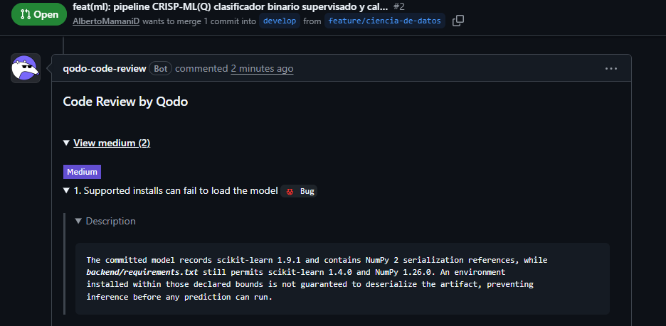
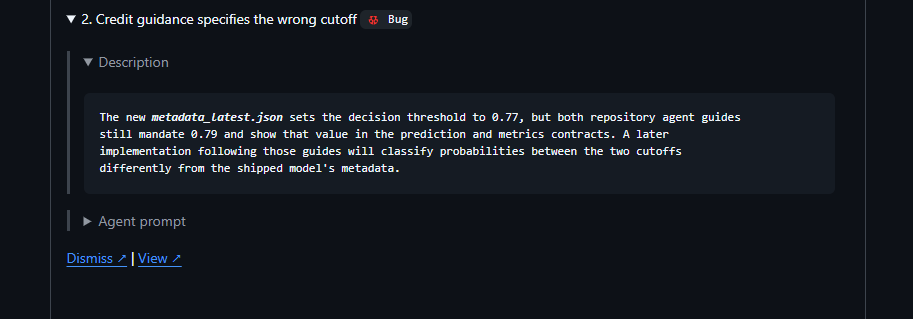

# Evidencia de IA para Revisión de Pull Requests (Plus)

Este directorio documenta el cumplimiento del **plus de la materia**: integración de una herramienta de Inteligencia Artificial para la revisión automatizada de código en Pull Requests (PR) sobre el repositorio de GitHub.

---

## 🤖 Herramienta Utilizada

Se recomienda una de las siguientes opciones según tu preferencia:
* **Opción A (Recomendada): Qodo Merge (anteriormente CodiumAI PR-Agent)**
  * Se instala como GitHub App oficial gratuita en el repositorio.
  * Revisa automáticamente cada Pull Request, genera un resumen de cambios, detecta posibles bugs de seguridad y sugiere mejoras de código directamente en los comentarios del PR.
* **Opción B: GitHub Action con OpenAI / Gemini API**
  * Un workflow en `.github/workflows/ai-pr-review.yml` que corre en cada `pull_request` y comenta el análisis del diff con IA.
* **Opción C: Copilot / ChatGPT Code Review**
  * Revisión asistida con capturas de pantalla de la interacción y aplicación de sugerencias en el PR.

---

## 📸 Guía para Obtener la Evidencia (Paso a Paso)

1. **Crear una rama de trabajo:**
   ```bash
   git checkout -b feature/servicio-ia-endpoints
   ```
2. **Hacer commits y empujar la rama:**
   ```bash
   git add .
   git commit -m "feat: implementar endpoints de predicción y reentrenamiento"
   git push origin feature/servicio-ia-endpoints
   ```
3. **Abrir el Pull Request en GitHub:**
   * Ir a tu repositorio en GitHub y crear el PR hacia la rama `main`.
4. **Disparar la revisión con IA:**
   * Si usas Qodo Merge (PR-Agent), comenta en el PR:
     ```text
     /review
     ```
     o
     ```text
     /describe
     ```
   * La IA responderá analizando la calidad, cobertura, posibles fallos y consistencia de la implementación.
5. **Capturar las evidencias:**
   * Tomar capturas de pantalla de:
     1. El comentario generado por la IA en el Pull Request.
     2. Las sugerencias de código sugeridas por la IA.
     3. La aceptación/merge del PR tras la revisión.
   * Guardar las imágenes en esta carpeta (`docs/evidencia-pr/captura1_revision_ia.png`, etc.) y referenciarlas abajo.

---

## 📑 Registro de Evidencias

| N° | Pull Request | Rama Origen ➔ Destino | Descripción del Cambio | Revisión y Observaciones de la IA (Qodo Merge) | Captura de Evidencia | Resolución Implementada |
|---|---|---|---|---|:---:|---|
| 1 | **PR #1: CRISP-ML(Q)** | `feature/ciencia-de-datos` ➔ `develop` | Publicación del modelo supervisado (`model_latest.joblib`), metadatos (`metadata_latest.json`) con 4/4 metas y configuración de dependencias. | **Detectó 2 bugs de nivel Medium:**<br>1. *Dependencies mismatch:* `scikit-learn 1.9.1` y `numpy 2` en serialización vs bounds permisivos en requirements.<br>2. *Threshold consistency:* `metadata_latest.json` tiene umbral 0.77 mientras `AGENTS.md` decía 0.79. | <br> | **Resuelto:**<br>1. Fijar `scikit-learn==1.9.1` y `numpy>=2.0.0` en `requirements.txt` y `backend/requirements.txt`.<br>2. Sincronizar `threshold = 0.77` en `AGENTS.md` y `.github/AGENTS.md`.<br>3. Incluir `model_v20261117002816.joblib` y permitir `!artifacts/model_*.joblib` en `.gitignore`. |

