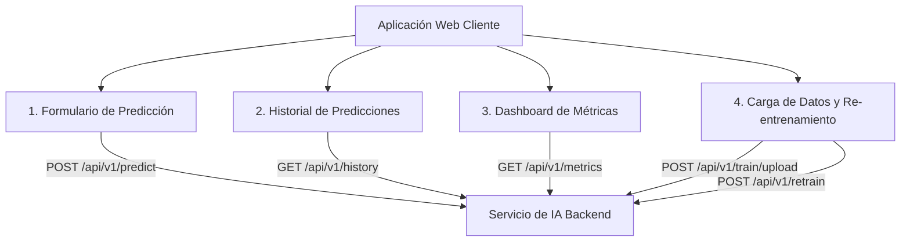

# Frontend: Aplicación Web Cliente para el Servicio de IA

Este directorio contiene la interfaz gráfica de usuario encargada de consumir e interactuar con **todos** los endpoints expuestos por el Servicio de IA (API REST).

---

## 🖥️ Módulos de la Interfaz y Cobertura de Endpoints

La aplicación web provee una experiencia intuitiva dividida en 4 vistas o pestañas principales:



### 1. Formulario de Inferencia (`POST /api/v1/predict`)
* Formulario estructurado para ingresar atributos de una persona: edad, estado civil, ocupación, horas semanales de trabajo, relación familiar, nivel educativo, etc.
* Botón **"Predecir Ingreso"**.
* Tarjeta de resultados en tiempo real:
  * Etiqueta destacada: **`>50K`** (Apto para crédito de alto monto) o **`<=50K`** (No califica).
  * Probabilidad calculada (barra de progreso visual).
  * Tiempo de respuesta del modelo en milisegundos.

### 2. Historial de Predicciones (`GET /api/v1/history`)
* Tabla interactiva que consulta el registro persistido en Supabase.
* Muestra: ID, fecha/hora, resumen de datos ingresados, resultado obtenido, probabilidad y latencia.
* Soporte para refresco manual o automático, y ordenación cronológica.

### 3. Dashboard de Rendimiento (`GET /api/v1/metrics`)
* Visualización gráfica de las métricas clave de calidad del modelo actual:
  * **MCC (Matthews Correlation Coefficient):** Métrica principal de negocio para clases desbalanceadas.
  * **ROC-AUC Score**
  * **Precisión, Recall y F1-Score**
  * **Matriz de Confusión** (conteo de TP, FP, TN, FN).
  * Identificador de versión del modelo activo y fecha de su último entrenamiento.

### 4. Módulo de Re-entrenamiento (`POST /api/v1/train/upload` y `POST /api/v1/retrain`)
* **Subida de CSV:** Zona drag & drop o selector de archivos para cargar un nuevo archivo `adult.csv` o lote de entrenamiento. Muestra validación de archivo y total de filas procesadas.
* **Acción de Re-entrenamiento:** Botón **"Re-entrenar Modelo Ahora"** que dispara el reentrenamiento en el backend, mostrando una barra de carga/spinner y confirmando las nuevas métricas obtenidas.

---

## 🚀 Tecnologías Sugeridas para el Cliente

Se puede implementar mediante cualquiera de los siguientes enfoques según preferencia de stack:
1. **Frontend Moderno Single Page App (SPA):** React + Tailwind CSS / Vite (muy fluido, profesional y responsivo).
2. **Dashboard Python Interactivo:** Streamlit (muy rápido de integrar y con componentes nativos de Data Science y subida de archivos).
3. **HTML5 + JavaScript Vanilla + Tailwind CDN:** Liviano, sin necesidad de Node.js, listo para servir estáticamente.

---

## ⚡ Guía de Ejecución

Para iniciar la interfaz (ejemplo con servidor local):
```bash
cd frontend
# Si es React/Vite:
npm install
npm run dev

# Si es HTML/JS estático:
python -m http.server 3000
```
Abrir en el navegador: `http://localhost:3000` (o el puerto configurado).
Asegurarse de que el backend esté corriendo en `http://localhost:8000`.

