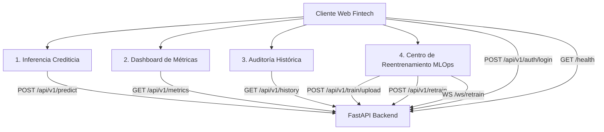

# Frontend: Aplicación Web Cliente para el Servicio de IA (CRISP-ML(Q))

Interfaz gráfica de usuario financiera moderna, accesible, responsiva y desacoplada, construida con **HTML5 Semántico, CSS3 Puro (Variables y Fintech Design System) y Vanilla JavaScript ES6+ Modular**, consumiendo el 100% de los endpoints REST y canales WebSocket del Servicio de IA.

---

## 🏛️ Arquitectura del Sistema Frontend

La aplicación sigue el principio de separación estricta de responsabilidades (SoC) sin bundles monolíticos ni dependencias de frameworks pesados:

```
frontend/
├── index.html                 # Punto de entrada raíz para servidores estáticos
├── public/
│   └── index.html             # Documento HTML5 semántico puro (W3C standard)
├── src/
│   ├── app.js                 # Orquestador principal, router de pestañas y modales
│   ├── styles/
│   │   ├── variables.css      # Tokens de diseño Fintech (Slate 900, Blue 600, Emerald, Red, Amber)
│   │   ├── base.css           # Reseteo universal, tipografía Inter y layout responsivo
│   │   ├── components.css     # Tarjetas, botones, inputs, badges, tablas, modales y toasts
│   │   └── modules.css        # Layouts específicos de los 4 módulos
│   ├── services/
│   │   ├── apiService.js      # Cliente HTTP & WebSocket (fetch, timeout, JWT, reconexión)
│   │   └── stateService.js    # Gestor de estado reactivo (pestañas, conexión, versión activa)
│   └── components/
│       ├── navbar.js          # Encabezado institucional, selector de pestañas y status pill
│       ├── predictor.js       # Módulo 1: Formulario 12 atributos, presets y tarjeta de decisión
│       ├── metricsDashboard.js# Módulo 2: 5 KPIs, matriz de confusión y costo bancario (3×FP + 1×FN)
│       ├── historyTable.js    # Módulo 3: Auditoría paginada en Supabase PostgreSQL
│       └── retrainCenter.js   # Módulo 4: Drag & Drop CSV, WebSocket stream y progreso en vivo
└── README.md
```

---

## 🖥️ Módulos Implementados y Cobertura de Endpoints



### 1. Inferencia Predictiva en Tiempo Real
* **Formulario Demográfico:** 12 variables censales estandarizadas (`age`, `workclass`, `education_num`, `marital_status`, `occupation`, `relationship`, `race`, `sex`, `capital_gain`, `capital_loss`, `hours_per_week`, `native_country`).
* **Botones Demo:** Carga instantánea de perfiles precalificados (*"Ejemplo Solvente (>50K)"* y *"Ejemplo Riesgo (<=50K)"*).
* **Tarjeta de Decisión:** Probabilidad calibrada con barra de progreso cromática, etiqueta de clase (`>50K` aprobado en esmeralda, `<=50K` no califica en rojo), latencia en ms y recomendación comercial bancaria.

### 2. Dashboard de Rendimiento MLOps
* **KPIs Clave:** Matthews Correlation Coefficient ($MCC = 0.6192 \ge 0.55$), ROC-AUC Score ($0.9217 > 0.85$), Precisión Solvente ($78.40\% \ge 75\%$), Sensibilidad / Recall ($62.50\% \ge 60\%$) y Umbral Óptimo ($\theta = 0.77$).
* **Matriz de Confusión Interactiva:** 6.508 solicitudes de validación ($TN: 4.670$, $FP: 270$, $FN: 588$, $TP: 980$).
* **Función de Costo Asimétrica Bancaria:** Cálculo automático del costo de riesgo $C = 3 \times FP + 1 \times FN$.

### 3. Auditoría y Trazabilidad en Supabase PostgreSQL
* **Historial Inmutable:** Visualización cronológica de solicitudes evaluadas por la API con identificación del modelo, parámetros clave, probabilidad y latencia.
* **Control de Acceso:** Protección mediante token JWT de analista financiero con paginación (`limit`, `offset`).

### 4. Centro de Reentrenamiento MLOps en Vivo
* **Ingesta de Datos:** Zona Drag & Drop para archivos `.csv` de hasta 50 MB con validación de columnas censales.
* **WebSocket Streaming:** Consola de ejecución en tiempo real (`WS /ws/retrain`) conectada al pipeline CRISP-ML(Q) con barra de progreso animada por etapas (25% Preprocesamiento $\rightarrow$ 50% Entrenamiento $\rightarrow$ 75% Evaluación $\rightarrow$ 100% Despliegue con Zero-Downtime).

---

## ⚡ Guía de Ejecución

### Opción A: Servir el Frontend con Python HTTP Server
```bash
# Desde la carpeta frontend
cd frontend
python -m http.server 3000
```
Abrir en el navegador: [http://localhost:3000](http://localhost:3000)

### Opción B: Abrir directamente con Live Server (VS Code / Antigravity)
Abrir el archivo `frontend/index.html` o `frontend/public/index.html` con cualquier servidor estático local.

> [!NOTE]
> Asegúrese de que el backend FastAPI esté ejecutándose en `http://localhost:8000`:
> ```bash
> cd backend
> uvicorn app.main:app --reload
> ```
